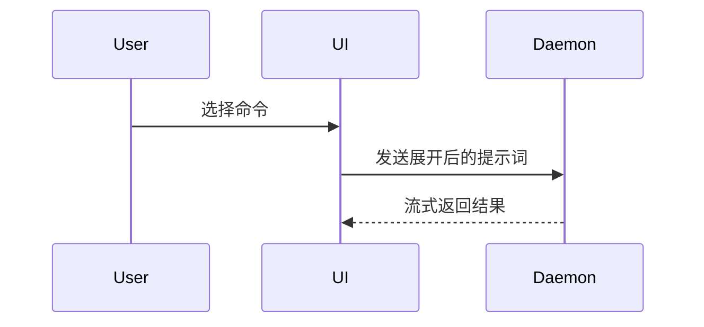

使用以下模板编写 PR 正文：

```markdown
## 摘要

<图表、差异草图或树形图>

## 证据

- **改动前：** <截图/输出/失败的测试运行>
  **改动后：** <截图/输出/通过的测试运行>

## 合并风险

**门的类型：** <单向或双向>

<可选：说明>

**影响范围：** <用一个词描述>

<可选：合并可能带来的影响>
```

## 各部分说明

省去所有开场白，文字保持简短。使用 `GLOSSARY.md` 中用户的领域语言。

### 摘要

选择能把关键点讲清楚的最小视图。

- 用伪代码展示逻辑或算法：

```text
on(save)
  if 内容未发生变化
    return 缓存结果
  写入新内容
  return 最新结果
```

- 用调用树展示运行时控制流：

```text
submitForm
  createSession
    persistPrompt
    launchAgent
  navigateToSession
```

- 用组件树展示 UI 结构，包含重要的状态和模块边界：

```text
<SessionPage> (apps/example/src/routes/session.tsx)
  useSessionEvents()
  <SessionToolbar>
    <RunSkillButton> (packages/ui)
```

- 用浅层文件树展示文件职责或大范围重构：

```text
src/
├── commands/       # 解析用户操作
├── sessions/       # 管理会话状态
└── transport/      # 发送 API 请求
```

- 用 Mermaid 展示组件交互、控制流或数据流：



- 当重点是发生了什么变化，而周围结构已经存在时，使用 `diff`。让差异展示的形式与主题相匹配。

对于组件变更：

```diff
 <SessionPage>
   useSessionEvents()
   <SessionToolbar>
+    <RunSkillButton />
   <SessionTimeline>
+    <SkillResultCard />
```

对于文件布局变更：

```diff
 src/
 ├── commands/
+│   └── show-me.ts       # 展开斜杠命令
 ├── sessions/
-└── transport.ts
+└── transport/
+    ├── client.ts
+    └── stream.ts
```

对于调用树或调用栈变更：

```diff
 submitForm
   createSession
     persistPrompt
+    expandSkillMention
     launchAgent
-  navigateToSession
+  navigateToSession
+    subscribeToEvents
```

对于状态或控制流变更：

```diff
 on(save)
-  写入内容
+  if 内容未发生变化
+    return 缓存结果
+  写入新内容
+  使缓存失效
```

- 当代码块大部分都是新增内容、省略上下文会掩盖归属或顺序，或者用户需要一份可复制的目标结构时，展示整个代码块：

```ts
function expandSkill(command: string): string {
  const skillName = command.slice(1);
  return `use the ${skillName} skill`;
}
```

#### 指导

将每个可视化内容放在它所支撑的简短文字旁边。只保留回答用户当前问题，或说明解决当前讨论点的选项所必需的调用、文件、属性、状态和边界。

你可以使用其中一种，也可以使用多种，但不太可能全部用上。自行判断，不要让用户应接不暇。

### 证据

提供改动有效的具体证据。展示改动前后的对比。

如果环境已准备就绪，且改动涉及视觉效果，截图就是 S 级证据。

基于实际执行的证据是 A 级证据，例如测试结果、控制台输出。用伪代码展示修复前失败、修复后通过的那个具体测试。

### 合并风险

说明这是单向门还是双向门。双向门可以走回去，单向门则不能。回滚成本低的 PR 风险较小。涉及破坏性操作或难以逆转的决策的改动，属于单向门。

影响范围是指该 PR 引入的改动可能造成的影响或波及范围。考虑所有可能性，例如布局偏移、导致使用方功能损坏、移动端响应式表现等。
